[简体中文](README.md) | **English**

<picture>
  <source media="(max-width: 640px) and (prefers-color-scheme: dark)" srcset="assets/presentation/hero-mobile-dark.svg">
  <source media="(max-width: 640px)" srcset="assets/presentation/hero-mobile-light.svg">
  <source media="(prefers-color-scheme: dark)" srcset="assets/presentation/hero-dark.svg">
  
</picture>

**ggufbill reads GGUF metadata and a whole-file digest, then saves operator-supplied runtime settings, hardware requirements and deployment notes in a JSON sidecar.**

`Go 1.24+ · Python 3 demo` · [MIT](LICENSE) · [GitHub](https://github.com/SuperMarioYL/ggufbill) · [Website](https://ggufbill.lei6393.com)

## Why it helps

Keeping only the model file can lose the context length, KV type and engine build used with it. A neighboring manifest makes those settings available for handover and review. The manifest records inputs and declarations; it does not prove a deployment runs or satisfies an audit requirement.

<picture>
  <source media="(max-width: 640px) and (prefers-color-scheme: dark)" srcset="assets/presentation/process-mobile-dark.svg">
  <source media="(max-width: 640px)" srcset="assets/presentation/process-mobile-light.svg">
  <source media="(prefers-color-scheme: dark)" srcset="assets/presentation/process-dark.svg">
  
</picture>

## Architecture

The GGUF reader extracts identity, architecture, quantization and parameter metadata and computes SHA-256. emit collects runtime, hardware and operator fields; manifest.Validate checks required values before JSON is written. inspect, audit and llama-server command synthesis are later-milestone interfaces.

<picture>
  <source media="(max-width: 640px) and (prefers-color-scheme: dark)" srcset="assets/presentation/architecture-mobile-dark.svg">
  <source media="(max-width: 640px)" srcset="assets/presentation/architecture-mobile-light.svg">
  <source media="(prefers-color-scheme: dark)" srcset="assets/presentation/architecture-dark.svg">
  
</picture>

## Install

Requires Go 1.24+ and Python 3 for the self-cleaning demo. Initial builds may download Go modules; the example downloads no model.

```bash
git clone https://github.com/SuperMarioYL/ggufbill.git
cd ggufbill
go build -o ggufbill ./cmd/ggufbill
```

## Quickstart

```bash
python3 examples/presentation_demo.py
```

The script uses the repository’s 318-byte metadata-only GGUF, emits a temporary manifest and reads its fields. It confirms a matching whole-file SHA-256, context_length=4096, kv=f16 and operator=demo-operator. Qwen3-27B is the fixture’s metadata name; no 27B weights are loaded.

## Usage

```bash
./ggufbill emit internal/gguf/testdata/qwen3-27b-q4_k_m.gguf --context 4096 --kv f16 --operator demo-operator --non-interactive --output demo.ggufbill.json
python3 -m json.tool demo.ggufbill.json
./ggufbill version
```

emit can prompt interactively. Scripts should provide --context, --operator and --non-interactive explicitly. --gpu-layers=-1 records a setting; it does not perform GPU offload.

## Capabilities and integrations

| JSON block | Source |
|---|---|
| model | GGUF metadata, filename and SHA-256 |
| runtime | Engine build, context, KV, GPU layers and extra flags |
| hardware | Operator-declared VRAM, GPUs and notes |
| quirks | Operator-declared tool support and known issues |
| audit | Emission time, operator, procurement reference and level label |

See [manifest.v0.1.json](schemas/manifest.v0.1.json) for the format.

<picture>
  <source media="(max-width: 640px) and (prefers-color-scheme: dark)" srcset="assets/presentation/integrations-mobile-dark.svg">
  <source media="(max-width: 640px)" srcset="assets/presentation/integrations-mobile-light.svg">
  <source media="(prefers-color-scheme: dark)" srcset="assets/presentation/integrations-dark.svg">
  
</picture>

## Configuration and limits

Common options include --context, --kv, --gpu, --gpu-count, --vram, --engine-build, --operator, --procurement-ref, --dengbao-level and --output. GPU names accept comma-separated or repeated values; an omitted engine build becomes unknown.

Protection-level labels, hardware capacity and tool_calling are declarations that the program does not verify. File hashes identify bytes; they are not signatures or provenance authentication. inspect/audit currently print unimplemented notices and should not be treated as validators or report generators.

## Recorded demo

Real emit and JSON readback (recorded on v0.1.0; the commands and output are unchanged in v0.2.0). Hardware, tool-calling reliability and regulatory compliance are not tested; temporary files are removed afterward.

[Inputs, commands and complete output](docs/demo-results.json)

[Retained terminal recording](assets/demo.gif) · [Recording script](docs/demo.tape). The replayable record above describes this example.

## Roadmap

- [x] GGUF reading, whole-file digest and manifest emission.
- [x] Interactive/non-interactive input and a machine-readable format.
- [ ] inspect verification and command synthesis.
- [ ] Multi-manifest audit reporting.
- [ ] More engines, signatures and organizational management.

No paid audit dashboard is currently provided.

## Development and license

```bash
go test ./...
```

The Go format lives in internal/manifest/manifest.go and the reader in internal/gguf/reader.go.

[MIT](LICENSE) · [Issues](https://github.com/SuperMarioYL/ggufbill/issues)
