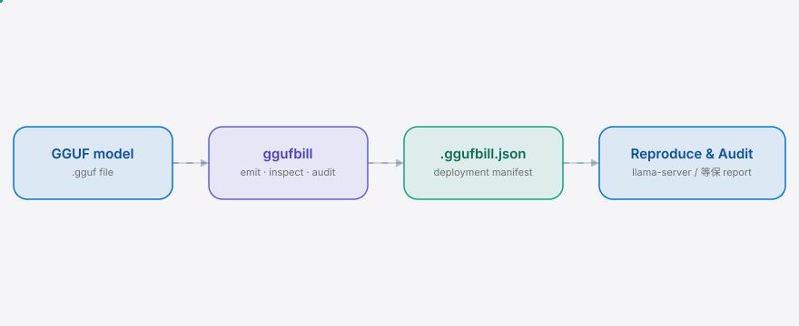
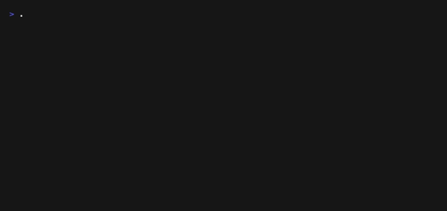

<div align="right"><sub><b>简体中文</b>&nbsp;&nbsp;⇄&nbsp;&nbsp;<a href="./README.en.md">English</a></sub></div>

<picture>
  <source media="(prefers-color-scheme: dark)" srcset="./assets/hero-dark.svg">
  <source media="(prefers-color-scheme: light)" srcset="./assets/hero-light.svg">
  
</picture>

<p align="center"><sub>ggufbill 是随 GGUF 传播的部署清单旁挂数据，让每一个 GGUF 部署可复现、可等保审计。</sub></p>

<p align="center">
  <a href="./LICENSE"></a>
  <a href="https://github.com/SuperMarioYL/ggufbill/releases"></a>
  
  
</p>

**把 Reddit 帖子里手写的 llama.cpp 配置，变成随 GGUF 传播、可等保审计的机器可读清单。**

<h2> 架构</h2>

<picture>
  <source media="(prefers-color-scheme: dark)" srcset="./assets/atlas-dark.svg">
  <source media="(prefers-color-scheme: light)" srcset="./assets/atlas-light.svg">
  
</picture>

一个 Go 二进制，三条子命令，一种旁挂数据格式，没有守护进程。`ggufbill emit` 读 GGUF header（arch、quant、params、sha256），写一份 `.ggufbill.json` 旁挂数据；这份清单随 `.gguf` 跨机器、跨重建传播，让运维复现已知良好的部署，让等保/信创采购拿到一个可核验的 per-box 工件。

<h2> 目录</h2>

- [为什么需要 ggufbill](#为什么需要-ggufbill)
- [安装与快速开始](#安装与快速开始)
- [用法](#用法)
- [演示](#演示)
- [清单格式](#清单格式)
- [付费与定价](#付费与定价)
- [路线图](#路线图)
- [许可证](#许可证)

<h2> 为什么需要 ggufbill</h2>

今天一个运维下载 GGUF 后，得靠翻 Reddit 帖子反推 serving 配置——上下文长度、KV cache dtype、多卡拓扑全靠散文评论传递，重建盒子就丢，等保审计没有 per-box 工件可查。r/LocalLLaMA 甚至有人[发帖请愿](https://www.reddit.com/r/LocalLLaMA/comments/1vqnbhe/petition_to_add_a_rule_for_people_to_add_their/)让作者披露 quant 配置，而那个 4×3060 DeepSeek V4 的[帖子](https://www.reddit.com/r/LocalLLaMA/comments/1vrqf4f/running_deepseek_v4_flash_q4_k_xl_at_100_toks/)本身就是一篇手写清单的散文——engine build、quant、KV-cache dtype、context window、多卡拓扑全是字段，却没有 schema。ggufbill 把这些字段变成随 GGUF 传播的 JSON 旁挂数据：重建不丢、跨引擎可读、等保可核验。

<h2> 安装与快速开始</h2>

单文件二进制，~10 秒装好。从冷克隆到首个可见结果三条命令：

```bash
git clone https://github.com/SuperMarioYL/ggufbill && cd ggufbill
go install github.com/SuperMarioYL/ggufbill/cmd/ggufbill@latest
ggufbill emit internal/gguf/testdata/qwen3-27b-q4_k_m.gguf --context 32768 --kv Q8_0 --vram 16 --gpu RTX-3060-12GB --operator 运维-张三 -o Qwen3-27B-Q4_K_M.ggufbill.json
```

<details><summary>示例输出</summary>

```
wrote Qwen3-27B-Q4_K_M.ggufbill.json
  model   Qwen3-27B (qwen2, Q4_K_M)
  params  27.0B  sha256 8c68c1bac72d…
  runtime llama.cpp unknown  ctx 32768  kv Q8_0  ngl -1
```
```json
{
  "$schema": "https://ggufbill.org/v0.1/manifest.schema.json",
  "manifest_version": "0.1",
  "model": { "name": "Qwen3-27B", "arch": "qwen2", "quant": "Q4_K_M", "params_b": 27, "file": "qwen3-27b-q4_k_m.gguf", "sha256": "8c68c1…" },
  "audit": { "emitted_by": "ggufbill 0.1.0", "operator": "运维-张三" }
}
```
</details>

仓库里内置一个合成的 Qwen3-27B Q4_K_M GGUF（`internal/gguf/testdata/`，~318 字节，元数据-only），所以上面的命令不需要先下 16GB 模型就能跑通。真实部署把 `.gguf` 换成你的模型文件即可。

<h2> 用法</h2>

```bash
# 读 GGUF header，交互式补全运行时/硬件/审计字段，写旁挂数据
ggufbill emit ./models/Qwen3-27B-Q4_K_M.gguf

# 一次性用 flag 给齐字段（脚本/demo 友好）
ggufbill emit ./DeepSeek-V4-Flash-Q4_K_XL.gguf \
  --context 360864 --kv Q8_0 --vram 12 --gpu RTX-3060-12GB --gpu-count 4 \
  --engine-build b10181 --operator 信创运维-李四 \
  --procurement-ref 信创采购-2026-GPU-014 --dengbao-level 等保三级 \
  --tool-calling --notes "4×3060 12GB 参考 r/LocalLLaMA 1M tokens 帖"

# （m2）校验清单 + 复现 llama-server 调用
ggufbill inspect Qwen3-27B-Q4_K_M.ggufbill.json

# （m3）等保部署审计视图
ggufbill audit *.ggufbill.json > 等保-部署审计.md
```

emit 的常用 flag：

| flag | 含义 | 示例 |
|---|---|---|
| `--context` | serving 上下文长度（token） | `32768` |
| `--kv` | KV cache dtype | `Q8_0`、`f16` |
| `--vram` | 单卡最小显存（GB） | `16` |
| `--gpu` | 目标 GPU 型号，可逗号分隔/重复 | `RTX-3060-12GB` |
| `--gpu-count` | 卡数 | `4` |
| `--engine-build` | llama.cpp build id | `b10181` |
| `--operator` | 部署责任人（必填） | `运维-张三` |
| `--procurement-ref` | 采购/资产单号 | `信创采购-2026-GPU-014` |
| `--dengbao-level` | 等保级别 | `等保三级` |
| `--tool-calling` | 该配置下工具调用可用 | — |
| `--breakages` | 已知故障 | `long-context-drift` |
| `-o` | 输出路径（默认旁挛在 .gguf 旁） | `out.ggufbill.json` |

> flag 可以写在文件路径前后（`emit <file> --flags` 或 `emit --flags <file>` 都行）；负数用等号形式（`--gpu-layers=-1`）。

<h2> 演示</h2>



从源码构建 → emit 一份 Qwen3-27B Q4_K_M 清单 → `jq` 检查。完整 tape 见 `docs/demo.tape`，CI 会按需重渲染 gif。

<h2> 清单格式</h2>

`.ggufbill.json` 是一个 SBOM 风格的部署工件，不是 llama.cpp CLI flag 的包装。完整 schema 见 [`schemas/manifest.v0.1.json`](./schemas/manifest.v0.1.json)（由 Go 结构体经 `invopop/jsonschema` 反射生成）。

| 区块 | 字段 | 说明 |
|---|---|---|
| `model` | name, arch, quant, params_b, file, sha256 | 从 GGUF header 读取的模型身份 |
| `runtime` | engine, engine_build, context_length, kv_cache_dtype, gpu_layers, extra_flags | 运维验证过的 llama.cpp 配置 |
| `hardware` | min_vram_gb, target_gpus, gpu_count, notes | 目标 GPU 硬件 |
| `quirks` | tool_calling, known_breakages | 该 quant/配置的已知行为 |
| `audit` | emitted_at, emitted_by, operator, procurement_ref, 等保_level | 等保/采购审计溯源 |

`procurement_ref` 与 `等保_level` 是付费层读同一个格式的楔子——CLI 永不收费，等保审计 dashboard 是付费层。

<h2> 付费与定价</h2>

CLI 与清单格式永久免费 MIT；商业化走等保审计 dashboard，读同一个 `.ggufbill.json`，不在 CLI 上设付费墙。

| 层 | 价格 | 适合 |
|---|---|---|
| **OSS CLI** | 免费（MIT） | 单兵/小队，本地 emit+inspect，数据不出境 |
| **Hosted 等保审计 dashboard** | ¥3,000/盒子/年 或 ¥30,000/年 团队版（≤5 测评员，不限盒子数） | 等保测评机构，聚合客户 GPU fleet 清单，一键生成测评报告 addendum，带 RBAC（初级测评员事后不可改清单） |
| **On-prem 私有部署** | ¥80,000/年 + 支持 | 拒绝审计方托管的国企/军工 tier |

- 数据不出境：hosted 走阿里云/华为云 + 微信支付/对公转账；on-prem 全内网。
- 第一付费客户：等保测评机构——每个测评 engagement 都收客户部署数据、手写测评报告，清单 addendum 省下 ≥1 人日/项目即签团队版，30 天内 pilot-to-paid。
- v0.1 不做 hosted；先把免费 CLI 与格式跑通，60 天内若有测评机构确认清单满足一个审计/采购条款，再开 hosted 层。

<h2> 路线图</h2>

- [x] **m1 — emit manifest**：`ggufbill emit` 读 GGUF header（arch、quant、params、sha256），写有效的 `.ggufbill.json` 旁挂数据。**（当前版本）**
- [ ] **m2 — inspect/reproduce**：`ggufbill inspect` 按 schema 校验旁挂数据、复核 GGUF sha256、输出精确 `llama-server` 调用 + 人类可读部署摘要。
- [ ] **m3 — 等保 audit report**：`ggufbill audit` 生成等保部署审计视图（markdown + HTML），per-box quant/context/hardware/operator/procurement_ref/等保_level。
- [ ] 未来：Unsloth/HuggingFace 发布侧自动 emit；组织清单 registry + RBAC（团队版 v0.2+）；manifest 签名 / Sigstore provenance；多引擎（vLLM、Ollama API、llama-server）。

<h2> 许可证</h2>

MIT，详见 [LICENSE](./LICENSE)。欢迎在 [Issues](https://github.com/SuperMarioYL/ggufbill/issues) 报 bug 或提 PR——尤其是把你手写的 llama.cpp 配置转成 `examples/` 里的 canonical 清单。

<p align="center"><sub><a href="./LICENSE">MIT</a> © 2026 SuperMarioYL</sub></p>
